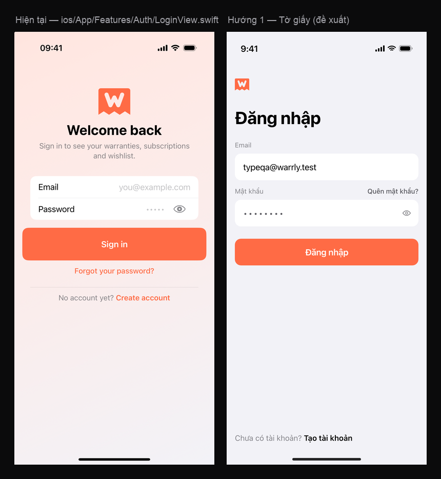
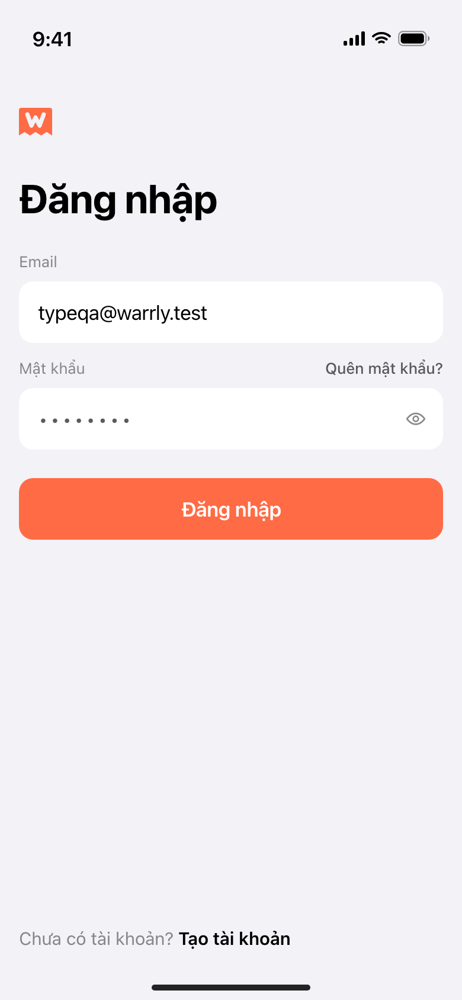
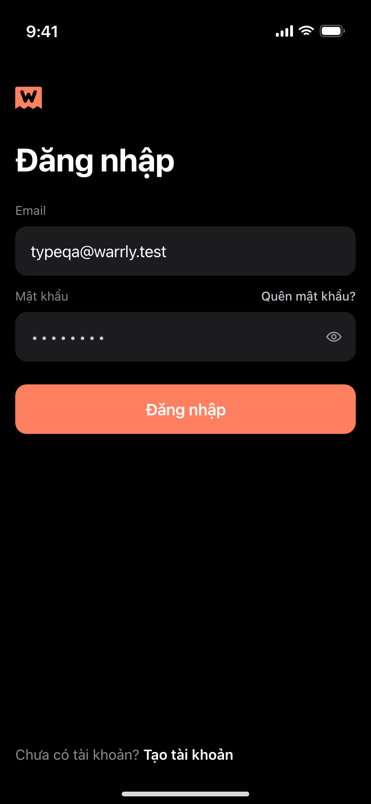
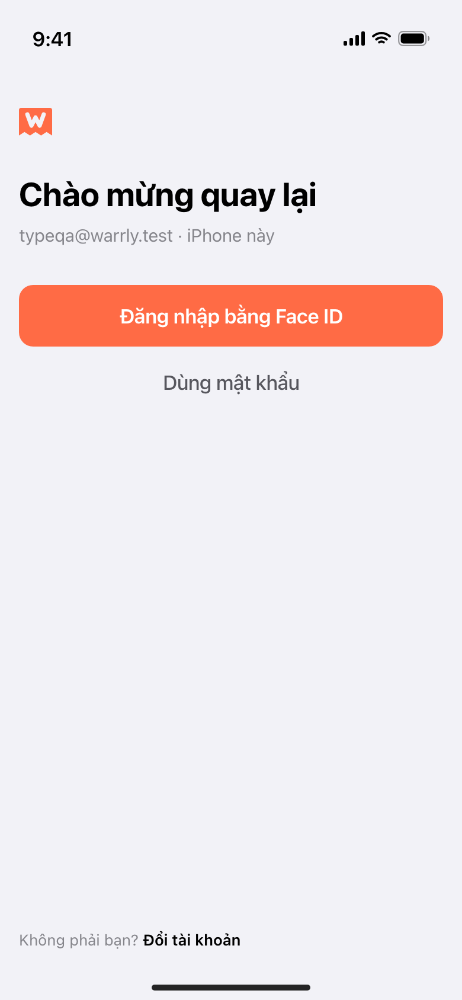
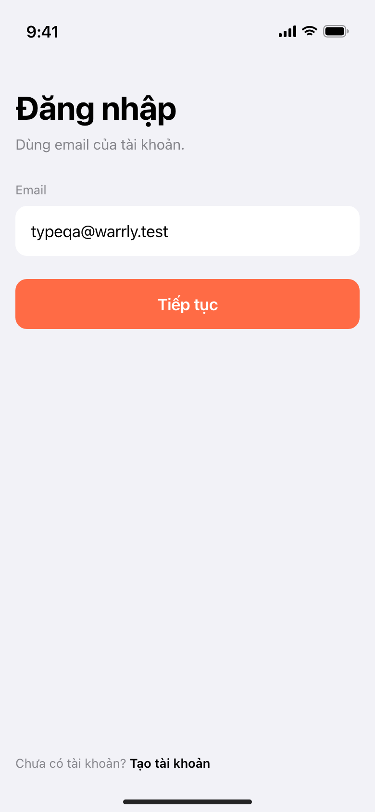
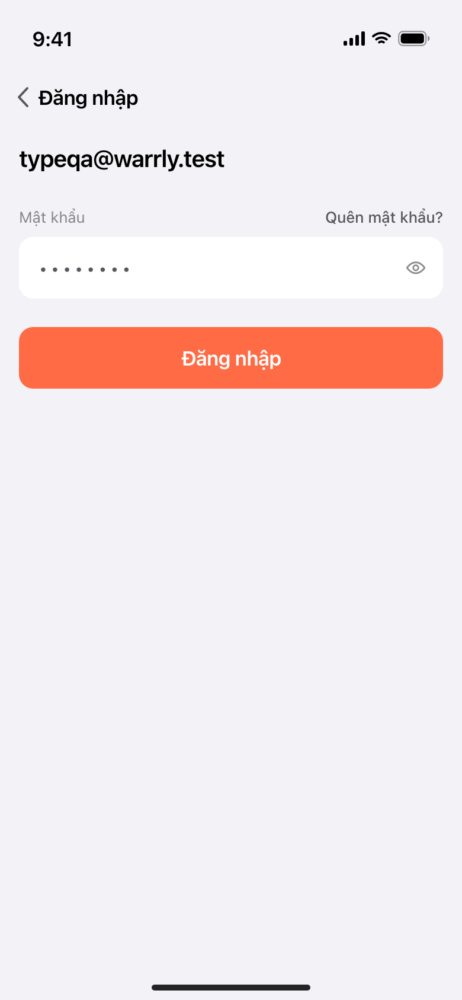
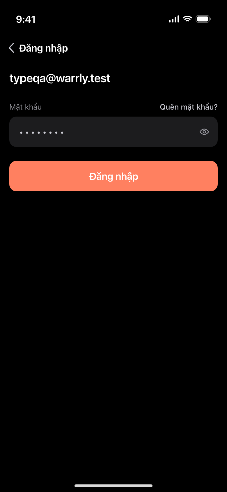

# Warrly iOS — the login screen, researched and redesigned

**Status:** proposal. Nothing in `ios/` was touched — this document and the images
next to it are the whole deliverable.
**Question asked:** the current login screen looks old-fashioned
(*"cái hiện tại tao thấy nó hơi cổ điển quá"*). What is actually dated about it,
what does a 2026 iOS login look like, and what should this one be?
**Out of scope:** Sign in with Apple (deliberately not built, `CLAUDE.md`), any
`api/` change, any new dependency. This is a SwiftUI app with no third-party UI
libraries and the design stays that way.

**How to read this.** Claims marked **[evidence]** can be checked: they are in the
file, in the screenshot, in Apple's documentation, or in a measurement. Claims
marked **[taste]** are my judgement and the owner may overrule them. Where a
judgement rests on evidence I say which.

**Files.** Mockups: `docs/handoff/login-redesign/` — each PNG is a 390 × 844 pt
frame rendered at 2× (780 × 1688) so it stays sharp when opened; open
`login-redesign/gallery.html` to see them all at once and
`login-redesign/before-after.png` for the single comparison that matters. Source of
the mockups: `render_mockups.py` + `render.sh` (headless Chrome). The mark
in every mockup is drawn from the `body` + `letter` paths in
`website/src/lib/brand.ts` (both cuts: `full` at ≥ 24 pt, `small` below), not
redrawn by eye. No mark in the three directions is below 24 pt, so all of them use
the full cut; `gallery.html` renders both cuts side by side (20 / 28 / 64 pt) to
show the renderer picks per size rather than scaling one drawing.

---

## 0. The answer

**Recommendation: Direction 1, "Tờ giấy" (The Ledger).** One day of work, no new
string, no new dependency, no API change, and it deletes every 2013 signifier on
the screen:

- the full-bleed coral gradient goes (the app's own visual direction deleted
  gradients from every other screen — this is the last one that is a *page*);
- the centred logo / centred greeting / centred block goes; the 34 pt title is
  the first thing on the screen and it is left-aligned at the 16 pt gutter;
- the field labels move **above** the fields, which is what stops the AX3
  clipping in `login-ax3.png` ("Ema il", "Pas swo rd");
- the label/value-right row (a 2010 Settings row) goes;
- the 66 pt painted-on CTA becomes a 52 pt button that is *visibly* disabled when
  it is disabled;
- and the screen finally does what every current iOS form does and this one does
  not: it chains the keyboard (Return → next field → submit) and declares the right
  `textContentType`, so the saved password can be filled in one tap.

It is also the only one of the three that cannot contradict
`docs/handoff/WARRLY-visual-direction.md`: it is the same paper, the same type
scale, the same 16 pt gutter, the same radii, one coral action.

Directions 2 and 3 are ranked below with their costs. Short version: **2 is the
better product and the worse first move** (it needs an OS behaviour I could not
verify without a build), and **3 is the one that would photograph best and be
worst in the hand** — Apple's own AutoFill documentation says the system assumes
the username and password fields are on the same page.

---

## 1. What is there now, measured

`ios/App/Features/Auth/LoginView.swift` (working tree at `c492d7d` + uncommitted
changes; the screenshots in `ios/build/qa-visual/login/` were taken from this
tree on 2026-10-31). **Line numbers are as of that tree** — another agent is
editing `ios/` while this document is being read, so treat them as a hint and
re-grep before acting on one.

What the screenshot literally contains, measured off
`login-default.png` (1206 × 2622 px at 3× → points) and confirmed against the
code:

| element | value | source |
|---|---|---|
| background | `brand.opacity(0.18) → bg`, top-leading → bottom-trailing | `LoginView.swift:28-33` |
| mark | 64 pt wide, ink at y = 111 pt, horizontally centred (x 164…226) | `LoginView.swift:70`; `WarrlyMark` at `Components.swift:1019` |
| title | `titleEmphasis` (28 bold), ink 19.1 pt tall, centred (x 103…287) | `LoginView.swift:73-76` |
| subtitle | `subheadline` (15), `label3`, centred, two lines | `LoginView.swift:77-81` |
| field group | white card, radius 12 — **inset 32 pt**, x 31…359 | measured; cause below |
| field row | 44 pt min height; label column **fixed at 100 pt**; value **right-aligned** | `LoginView.swift:206`, `:225` |
| primary button | **66 pt tall** (50 min-height + 8 + 8; measured 63.7), full width, x 16…374 | `Components.swift:423`, `:438-439` |
| "Forgot your password?" | below the button, `tint` (coral) + medium | `LoginView.swift:138-145` |
| divider | default `Divider()`, full width, above the register line | `LoginView.swift:153-154` |
| register line | 15 pt, coral + bold for the link half | `LoginView.swift:161` |
| content extent | ink ends at 526 pt of 844 — the bottom 38 % is empty | measured |

Two things in that table are worth stopping on, because they are the kind of
defect a user feels without being able to name:

1. **The card and the button do not share a left edge.** The card starts at
   32 pt, the button at 16 pt. The cause is a double gutter, and it is structural:
   `WVGroup` applies `.padding(.horizontal, WVSpacing.gutter)` *inside itself*
   (`Components.swift:187`) — that is how every grouped screen gets its inset, and
   Settings does not pad again. `LoginView` needs the 16 pt gutter for its
   full-width button, so it wraps the whole column in the same padding
   (`LoginView.swift:45`) — and the group inside it ends up at 32. The two things
   that must line up are 16 pt apart, and it is the only screen in the app where a
   group and a button share a column. **[evidence]**
2. **The button is disabled and painted as enabled.** `canSubmit` requires both
   fields (`LoginView.swift:171`), the button is `.disabled(...)` when they are
   empty (`:135`) — and the screenshot shows both fields empty with the button at
   full coral. `WVPressableStyle` never reads `isEnabled`
   (`Components.swift:449-453`), so SwiftUI's automatic dimming does not apply to
   a custom `ButtonStyle`. The loudest object on the screen is a control that
   looks live and does nothing. **[evidence]**

---

## 2. Why it reads old-fashioned

The brief offered six hypotheses. Four are true, one is false, and one is true
for a reason that is not obvious. Judged honestly:

| hypothesis | verdict |
|---|---|
| centred-everything vertical stack | **true** — and it is the biggest single cause |
| full-bleed gradient | **true** — and it is now the only one left in the app |
| the card separates the fields from the page | **false** — a white group on `bg` is the app's own grammar (`§4` of the visual direction). The card is not the offender; the gradient behind it is. The *32 pt* inset is a separate bug. |
| centred title | **true**, same cause as the stack |
| the single huge button | **true**, and worse than "huge": it is 66 pt and it is dead |
| absence of any modern affordance | **true** — this is the one that matters most |

Now the causes in order of how much they cost.

### 2.1 The page is a poster, not an app

Gradient + centred 64 pt logo + centred greeting + centred subtitle + one
full-width CTA is the grammar of a 2012 splash screen and of a web landing page.
An iOS app's first screen is a *page with a title*, left-aligned, at the same
16 pt gutter as everything else. **[evidence: the composition is measurable; the
"2012" attribution is taste]**

The sharpest fact is not the composition, it is the chronology: when
`WARRLY-visual-direction.md` was applied, **every gradient in the app was
deleted** — the three gradient heroes on Thống kê / Đăng ký / Wishlist, and with
them the category hues and the coloured icon tiles. `grep -rn LinearGradient ios/App` now returns five sites: the coral bar
fill in `Charts.swift` (legitimate data ink), the unused `brand: true` variant of
`WVWidget` (no call site), and the **three auth screens**. So the login screen is
the last full-page gradient in the product — the door to a flat, paper-coloured
app is painted like a different app. That is not a style opinion; it is now an
inconsistency, and inconsistency is what reads as "old". **[evidence]**

### 2.2 A 2010 Settings row used as a form

`Email        you@example.com` — label hard-left in a 100 pt box, value hard-right
— is the Settings.app label/value cell, a pattern built for read-only *values*.
It is not a text-field pattern: on iOS a text field leads with its text, because
that is where the insertion point is. Right-aligned input also breaks the moment
it is translated or enlarged: at AX3 the fixed 100 pt label column wraps
mid-word into **"Ema / il"** and **"Pas / swo / rd"**, and the field values
overlap them. `login-ax3.png` is the proof, and it is the single most damning
image in the set: the screen does not survive the accessibility setting that the
rest of the app was built for. **[evidence]**

### 2.3 Coral means four things on one screen

The visual direction allows coral exactly one job: *this is the action*, one per
screen (§5.1). On this screen coral is (1) the wash behind everything, (2) the
filled button, (3) the "Forgot your password?" link, (4) half of the "Create
account" line. Four meanings — the exact failure mode §1.2 of that document
diagnosed on the device list, still alive on the login. And because the whole
page is already 18 % coral, the button has to shout to be seen *as* the action.
**[evidence in the code and the shot; the "shout" reading is taste]**

### 2.4 The CTA is the loudest thing and it is a painted-on button

66 pt tall (measured; `WVButton` is `minHeight 50` plus 8 + 8 vertical padding,
`Components.swift:423/438-439`), full width, saturated, and — per §1 — dead to
touch until both fields have content, with no visual change. A 66 pt filled
button is also simply larger than iOS's own filled buttons (~50 pt); it is a web
"hero CTA" dropped onto a phone. **[evidence for the numbers; taste for the
verdict]**

### 2.5 The screen explains the product to someone who already installed it

> `Đăng nhập để xem bảo hành, đăng ký và wishlist của mày.`

Two problems in one sentence. First, this is what the App Store listing is for;
the person holding the phone has already installed the app. Second, **`mày`** —
the only occurrence of that pronoun in the whole iOS string catalog, against
132 lines of `Localizable.xcstrings` that contain `bạn`. The login screen is the one place
the app stops sounding like itself. **[evidence]**

### 2.6 The affordances that are absent (and so invisible)

Absences are hard to see in a screenshot, which is exactly why this is the
expensive one. All of these are missing today:

- **The screen never says how you get in.** Apple: *"Always identify the
  authentication method you offer… title it using a phrase like 'Sign In with
  Face ID' instead of a generic phrase like 'Sign In'."*
  ([HIG, Managing accounts](https://developer.apple.com/design/human-interface-guidelines/managing-accounts))
  With exactly one method, a generic "Sign in" is not itself a violation — there is
  nothing to disambiguate — so I will not pretend otherwise. What is missing is the
  method *story*: nothing on the screen offers the saved credential, nothing
  shortens the path for a returning user, and the one thing the platform provides
  for free (AutoFill) is wired to the wrong content type. **[evidence]**
- **The keyboard does nothing.** No `.submitLabel`, no `@FocusState`, no
  `.onSubmit` — pressing Return on the password field is a no-op.
  `LoginView.swift:218-226`. In every current iOS form Return moves to the next
  field and then submits. **[evidence]**
- **The email field declares the wrong content type.** It is
  `.emailAddress` (`LoginView.swift:97`). Apple's Password AutoFill table pairs
  the account field with `.username` and says: *"if your site uses email addresses
  as user names, set the `textContentType` property to `.username`, and set the
  `keyboardType` property to `.emailAddress`."* The keyboard type is right; the
  content type is wrong, which weakens exactly the saved-password association
  this screen depends on.
  ([Enabling Password AutoFill](https://developer.apple.com/documentation/security/enabling-password-autofill-on-a-text-input-view)) **[evidence]**
- **Nothing is remembered.** No last account, no "continue as", no saved-credential
  entry point. Every visit starts from an empty form.
- **"Forgot your password?" sits below the CTA**, where it competes with the
  action and catches the eye after the tap instead of where the problem occurs
  (next to the password). **[taste, but widely held]**
- **The subtitle is the only thing above the form**, so the first thing read is
  marketing copy rather than the task. **[taste]**

---

## 3. What changed in 2024–2026

Three things moved in the industry, one thing did not, and only one of the three
is about a screen.

### 3.1 Passkeys moved from "new" to "the default Apple asks for"

Apple's HIG now states a preference **chain**, in this order:

> "If you don't use Sign in with Apple in your iOS, iPadOS, macOS, or visionOS
> app, **prefer using a passkey**. Passkeys simplify account creation and
> authentication, eliminating the need for people to create or enter passwords.
> When an app supports passkeys, people simply provide their user name when
> creating a new account or signing in to an existing one."
> — [HIG, Managing accounts](https://developer.apple.com/design/human-interface-guidelines/managing-accounts) **[evidence]**

WWDC25's *What's new in passkeys* adds the numbers and the 2025 platform work:

> "In 2025, the FIDO Alliance … did a study and found **69 % of people surveyed
> have at least one passkey**. Google published that people signing in with
> passkeys are **four times more successful** at getting into their accounts than
> those using passwords. And TikTok has observed a … **97 % sign-in success rate**
> for people using passkeys."
> — [What's new in passkeys, WWDC25](https://developer.apple.com/videos/play/wwdc2025/279) **[evidence, as Apple's summary of third-party numbers]**

iOS 26 also added **automatic passkey upgrades** — the OS can offer to turn an
existing password account into a passkey one — plus a passkey account-creation
API and passkey management endpoints (same session). **[evidence]**

So: **is a password field still the primary affordance in 2026?** By Apple's own
guidance, no — it is the third choice, after Sign in with Apple and passkeys. But
that is a *product* answer, not a screen answer. Warrly has no passkey support and
no Sign in with Apple, and both are backend projects (WebAuthn ceremonies on the
Go side; identity-token verification for SIWA). What the platform makes possible
**today, with the existing `POST /api/v1/auth/login`**, is narrower and real:

| API | what it gives a password-only app | status here |
|---|---|---|
| `textContentType` `.username` + `.password` | Password AutoFill: the saved credential appears in the QuickType bar and fills both fields in one tap, Face ID-gated | available, **mis-wired today** (`.emailAddress`) |
| `ASAuthorizationPasswordRequest` (`ASAuthorizationPasswordProvider`, iOS 13+) | A native sheet that hands the app the stored username **and** password — the "Sign in with Face ID" button, no server change | available; empty-state behaviour needs a spike (§6) |
| `ASAuthorizationPlatformPublicKeyCredentialProvider` + `performRequests(options: .preferImmediatelyAvailableCredentials)` (iOS 16+) | Silent passkey assertion, presented only if a credential is on the device | needs WebAuthn in `api/` — out of scope |

The honest reading: the login screen cannot become a passkey screen in this
project, but it can stop pretending the password is typed from memory.

### 3.2 Sign in with Apple — does its absence make the screen look dated?

**No, and the reason is worth writing down.** Two facts:

1. **The App Store rule is conditional.** Guideline 4.8 makes Sign in with Apple
   (or an equivalent privacy-preserving login) mandatory when an app *offers
   another third-party or social login service*. Warrly offers none — the Settings
   row says "Chưa khả dụng" for both Apple ID and Google — so 4.8 is not
   triggered. ([App Review Guidelines](https://developer.apple.com/app-store/review/guidelines/)) **[evidence]**
2. **An absent Apple button does not read as old; an absent method story does.**
   Look at Apple's own account sheet: a title, one field, "Continue". No logo, no
   gradient, no third-party buttons. What dates the Warrly screen is not the
   missing Apple button, it is the poster composition around a form. **[taste, informed
   by §3.1]**

The alternative to Sign in with Apple, per Apple's own HIG, is **passkeys**, and
the second-best is a password path that behaves like a first-class method
(saved-credential sign-in, named action, correct AutoFill wiring). That is what
Directions 1 and 2 do. `CLAUDE.md` also lists SIWA as deliberately not built for
reasons that are still true (paid developer account, server-side token
verification, account linking), so this document does not propose it. **[evidence
for the constraint; the conclusion follows]**

### 3.3 Email-first, or both fields at once?

Define the two shapes:

- **Both fields** (today): email and password visible together.
- **Email-first / two-page**: type the email, tap Continue, the password appears
  on the next screen. Shopify, Google, Microsoft do this.

Why the big services do it: **routing**. One email address can map to a password
account, an SSO tenant, or a social identity, and the second page can be created
for the right one. Vitaly Friedman's summary of the trade-off is blunt:

> "2-step-logins often **break autofill and password managers**. And for most
> users, login/pass is way faster than 2-step-login." He recommends the inverse:
> show email + password together, and *conditionally* reveal an SSO option once
> the email identifies one.
> — [2-Page Login Pattern, And How To Fix It](https://smart-interface-design-patterns.com/articles/2-page-login-pattern/) **[evidence, as expert synthesis rather than a controlled study]**

Apple says the same thing at the API level, and this is the line that decides it
for Warrly:

> "the heuristics assume the user name and password inputs are **on the same
> page**. If you have a multipage login form, explicitly setting the `.username`
> and `.password` types lets the user tap and fill those inputs, even if they're
> on separate pages."
> — [Enabling Password AutoFill](https://developer.apple.com/documentation/security/enabling-password-autofill-on-a-text-input-view) **[evidence]**

And Warrly cannot even cash the one benefit email-first sells. Splitting the form
only pays off if step one can *tell the user something* — "this email has no
account, create one here". The API deliberately refuses to say that: unknown email
and wrong password return the same `401 invalid_credentials`
("Email hoặc mật khẩu không đúng", `api/internal/handlers/auth.go:369-380`), which
is the correct anti-enumeration behaviour. An email-first screen on this API would
be a page turn that answers nothing. **[evidence]**

**Verdict:** both fields on one screen. The defensible middle is a password that
appears *in place* once the email is valid — no page turn, no broken heuristic —
and that is not one of the three directions below, because it buys a tap's worth of
calm for a tap's worth of friction. Direction 3 is the navigated version of the
same trade, and it is ranked last for exactly this reason. **[taste]**

### 3.4 What a login screen for a *utility* should look like

Apple is unusually direct about the gate itself:

> "Ask people to create an account only if your core functionality requires it…
> **Delay sign-in for as long as possible.** People often abandon apps when
> they're forced to sign in before they can do anything useful."
> — [HIG, Managing accounts](https://developer.apple.com/design/human-interface-guidelines/managing-accounts) **[evidence]**

Warrly's core function is server-side and per-user, so the gate is required; the
HIG sentence then becomes an argument about *tone*, not about removing the gate.
The product's job is "remember my warranties". The person signing in is usually
the same person who signed in last month, on the same phone, with the password
already in the keychain.

That gives three design rules this document uses:

1. **A door with a handle, not a lobby.** No marketing, no feature tour, no brand
   performance. The screen's job is to get a known person through in one or two
   taps, and an unknown person into the register sheet in one.
2. **Brand is the material, not the wallpaper.** The mark at 28 pt, the coral on
   one control, SF type at the app's own scale. **[taste]**
3. **The fallback is the design.** Passwords are the fallback in 2026; make the
   fallback feel deliberate — named, chained to the keyboard, AutoFill-wired —
   instead of making it feel like a form someone was too busy to finish. **[taste]**

### 3.5 What did *not* change

The text field, the grouped row, the 34 pt title, the filled button, SF Pro. iOS
26 restyled system chrome around the content (`Adopting Liquid Glass` tells apps
to prefer standard components over custom-drawn ones —
[developer.apple.com](https://developer.apple.com/documentation/technologyoverviews/adopting-liquid-glass)),
and the practical consequence for this screen is not "add glass", it is "stop
drawing a custom background". A login built from standard fields on the app's own
paper is *more* current than one built from a gradient and a floating card. **[evidence
for the guidance; taste for the application]**

---

## 4. Three directions

Each is a different answer to a different question. All are 390 pt wide. Light and
dark. The rendered PNGs are the source of truth for spacing.

### Direction 1 — **Tờ giấy** (The Ledger) — *rank 1*

> **The idea in one sentence:** the login is a page of the app, not a poster in
> front of it — a 34 pt title at the 16 pt gutter, two labelled fields, one coral
> button, and the brand reduced to a 28 pt mark standing where a navigation bar
> would be.

**What it looks like.** `bg` page, no gradient. Top to bottom at the 16 pt
gutter: the mark (28 pt, full cut, brand), 32 pt, `Đăng nhập` at 34/41 bold, 24 pt,
`Email` label 13 `label3` above a 52 pt white field, 12 pt, the `Mật khẩu` label
with `Quên mật khẩu?` right-aligned on the same 13 pt line, the password field
with the eye inside, 24 pt, one coral 52 pt button, radius 12. The
`Chưa có tài khoản? **Tạo tài khoản**` line is pinned to the bottom of the safe
area, with the link in `label` **semibold** rather than coral — emphasis by
weight, not by colour, so coral stays the action's alone. Two coral things on the
screen in total: the mark and the button.

**Why these choices, not others.**

- The mark is 28 pt, not 64, and it sits above the title only as a
  navigation-bar would: §7's rule is that nothing above the lead may compete with
  it. A 64 pt logo is a hero; a 28 pt one is wayfinding — and it is the only
  wayfinding this screen has, since it has no navigation bar.
- Labels above fields, not placeholders in them, because a placeholder disappears
  on the first keystroke and because this is exactly the layout that survives
  AX3 (`login-redesign/d1-ax3-light.png`). Apple sanctions both ("provide an
  introductory label that describes the information, like 'Email'",
  [HIG, Entering data](https://developer.apple.com/design/human-interface-guidelines/entering-data)).
- The email is **pre-filled with the last account used on this device** (one
  string in `UserDefaults`, written on successful login). This is Direction 2's
  whole idea shrunk to its cheapest useful part: it removes the "which email did
  I use?" moment without a greeting card and without storing anything sensitive.
  Apple's rule applies and is obeyed: *"Never prepopulate a password field"*
  (same HIG page).
- `Quên mật khẩu?` moves next to the password, where the problem is.

**Cost to build.** One day, one file plus a small `WVButton` fix:

| work | where | size |
|---|---|---|
| new layout (mark, title, labels, fields, button, footer) | `LoginView.swift` | ~130 lines rewritten |
| focus chain + submit labels | `LoginView.swift` | ~8 lines |
| `.username` content type, `keyboardType: .emailAddress` | `LoginView.swift` | 2 lines |
| remembered email in `UserDefaults` | `LoginView.swift` / `AuthStore` | ~10 lines |
| disabled state that looks disabled | `WVPressableStyle` in `Components.swift` (~4 lines) — **shared file, coordinate with whoever owns it** | 4 lines |
| delete the gradient + the 100 pt label column + the `Divider()` | `LoginView.swift` | deletion |
| new localized strings | — | **none** |

**What could go wrong.** (a) The 40 % of empty screen below the button can read as
unfinished to the owner — the footer line is the only thing holding the bottom
edge, and if it is dropped the screen will look truncated. (b) Removing the
gradient makes the screen quieter; if the owner wanted "more lively", this is the
wrong direction and he should say so. (c) The `WVButton` disabled fix touches a
shared component that another agent may be editing — land it separately or accept
a local style for one release.

### Direction 2 — **Người quen** (The Regular) — *rank 2*

> **The idea in one sentence:** the app already knows who you are, so the screen
> opens as a greeting and a single button, and the form only exists if the
> one-tap path fails.

**What it looks like.** The 28 pt mark, `Chào mừng quay lại` at 28 pt, and the account
this device belongs to underneath it (`typeqa@warrly.test · iPhone này`). One coral
button, `Đăng nhập bằng Face ID` — the label names the method, per HIG — a plain
text button `Dùng mật khẩu` under it, and `Không phải bạn? **Đổi tài khoản**` at
the bottom. There are no fields on the default state.

**How it works without a server change.** The button presents
`ASAuthorizationPasswordRequest`; the system returns the username and password
stored for the app in iCloud Keychain after Face ID; the app posts them to
`POST /api/v1/auth/login` exactly as it does today. It is a *local* convenience,
not a new authentication method — no API change, no new secret, no token
verification.

**Cost to build.** 3–4 days, and one of those days is a spike:

| work | size |
|---|---|
| persist account (email + `displayName`; the login response already carries `res.user`, `AuthStore.swift:71-78`) | ~30 lines |
| second state in `LoginView` + transitions to/from the form | ~60 lines |
| `ASAuthorizationController` + password request + error paths | ~80 lines, one new file |
| **spike:** what `ASAuthorizationPasswordRequest` does on a device with no saved credential — I could not verify this from the docs (§6) | ½ day, on a device |
| label must follow `LABiometryType` (Face ID / Touch ID / "mật khẩu đã lưu") — HIG requires it | small, but it is a real branch |
| privacy decision: the account email is now on the pre-auth screen | owner's call |

**What could go wrong.** (a) If no credential is stored, the button can dead-end;
the mitigation is to show it only after the device has logged in once — but that
still is not a guarantee, hence the spike. (b) A shared phone shows whose account
it is to whoever opens the app; that is a privacy change the owner should approve
explicitly. (c) A password changed elsewhere makes Face ID "work" and the login
fail — the error path must fall through to the form, prefilled. (d) It is
*additive*: the fields from Direction 1 are still needed as the fallback, which is
why it cannot come first.

### Direction 3 — **Hai nhịp** (Two Beats) — *rank 3, not recommended*

> **The idea in one sentence:** one question per screen — the email first, then the
> password on a second beat that confirms which account it is for.

**What it looks like.** Beat one: `Đăng nhập`, one line of instruction, the email
field, `Tiếp tục`. Beat two: a back chevron with `Đăng nhập`, the account in 20 pt
semibold, the password field, `Đăng nhập`. Each screen holds exactly one decision.

**Cost to build.** 2 days — a two-state view, no new API, no new system
framework. Cheaper than Direction 2.

**Why it is ranked last despite photographing best.** Three reasons, and the first
is not a matter of taste:

1. **It fights AutoFill.** Apple's documented heuristic assumes the username and
   password are on the same page; splitting them makes the one-tap saved-credential
   fill harder, not easier. On the platform whose password manager is the reason
   most people can sign in at all, that is paying twice. **[evidence]**
2. **It cannot deliver its own promise.** The reason to split is to route by
   account (SSO, "no account here, create one"). This API returns the same
   `invalid_credentials` for both, by design, so step one's answer is always
   "maybe". A page turn that answers nothing is friction without information.
   **[evidence]**
3. **It is one extra tap on the common path** — the returning user, who is almost
   every user of a personal warranty tracker. **[taste informed by §3.4]**

It is the direction a designer picks from a screenshot; it is not the one the
research picks for this product.

---

## 5. Ranking

| | removes | consistency with the app's language | cost | risk | what it is | **rank** |
|---|---|---|---|---|---|---|
| **1 Tờ giấy** | gradient, centred hero, label column, 66 pt CTA, dead button — plus the wiring the current screen is missing (keyboard chain, `.username`, remembered email, visible disabled state) | full — it *is* the app's language | 1 day | very low; no new state, no OS API | the door | **1** |
| **2 Người quen** | all of the above, **and** the form itself for a returning user — one named biometric action instead of two fields | full, and it adds a greeting the app never had | 3–4 days | medium — one unverified OS behaviour, one privacy decision | the doorman who knows you | **2** |
| **3 Hai nhịp** | gradient, label column, 66 pt CTA, dead button; keeps an instructional subtitle and moves half the form to a second screen | full | 2 days | low technically, high product-wise — it fights AutoFill and answers nothing | the interview | **3** |

**Recommendation: Direction 1.** It is the only one that is a pure removal of the
things that make the screen look old, it is one day, it needs no new string, and
it cannot contradict the visual direction because it is made of that document's
own parts. Direction 2 is the better *product* and the worse *first move*: it
needs an OS behaviour I could not verify without building, and it needs the fields
from Direction 1 anyway.

**The one line to borrow from Direction 2 now:** the remembered email in the
email field. Ten lines, no API, no privacy question worth the name (the keychain
already holds the password), and it removes the only moment on the screen where a
returning user has to remember something.

**When to build Direction 2:** after Direction 1 has shipped and the owner has
spent 30 minutes with `ASAuthorizationPasswordRequest` on a device that has never
saved a password for Warrly. If that behaves (a clear "not now" rather than a dead
end), the Face ID state is a 3-day sequel, not a redesign.

---

## 6. The spec for Direction 1, so it can be built without me

**Geometry** (390 pt reference, safe-area-relative). Every value is on the 4 pt
scale of the visual direction §3.

| from | to | gap |
|---|---|---|
| safe area top | mark | 32 |
| mark (28 × 23.4, full cut, `WVColor.brand`) | `Đăng nhập` | 32 |
| title 34/41 bold, `label`, tracking −0.4 | `Email` label | 24 |
| label 13/18 `label3` | field | 8 |
| field `minHeight 52`, radius 12, `bg2`, value 17 | `Mật khẩu` label row | 12 |
| label row (label left, `Quên mật khẩu?` right, 13 medium `label2`) | field | 8 |
| field `minHeight 52` + eye 44 × 44 inside | button | 24 |
| button 52, radius 12, `tint`, title 17 semibold white | — | — |
| safe area bottom | `Chưa có tài khoản? **Tạo tài khoản**` 15/20 | 8 |

Notes that are not negotiable:

- **`minHeight`, never `height`**, on both fields — that is what lets them grow at
  AX sizes. The label row wraps via `ViewThatFits` (HStack at default, VStack at
  AX4+) instead of clipping.
- **The card disappears.** Two separate 52 pt fields on the page, not a white
  group. Do **not** wrap them in `WVGroup` inside the padded column: its built-in
  16 pt gutter is what produced the 32 pt card inset in §1. (If the owner prefers
  the grouped look, `WVGroup` must sit *outside* the column that the button is
  padded by — one gutter, one left edge.)
- **The footer is in the scroll content**, pushed down by a flexible spacer with
  `minLength: 24` — not an overlay. With the keyboard up it scrolls away instead of
  floating above the keys.
- **No `Divider()`** anywhere on this screen. The footer line separates itself by
  position.
- **Coral budget:** the mark's plate + the one button. `Quên mật khẩu?` and
  `Tạo tài khoản` are `label2` / `label` semibold — no coral text.

**Behaviour**

| concern | behaviour |
|---|---|
| email field | `.textContentType(.username)`, `.keyboardType(.emailAddress)`, `.submitLabel(.next)`, `.onSubmit` → focus password |
| password field | `.textContentType(.password)`, `.submitLabel(.go)`, `.onSubmit` → submit; eye toggle keeps `WVPasswordField`'s existing accessibility labels |
| remembered email | write on successful login (`AuthStore.login`), read at `LoginView.init`; never the password |
| disabled button | disabled until both fields are non-empty **and** painted as disabled (`fill3` + `label3`). Today's silent-dead-coral is the bug |
| errors | field errors 13 pt `red` 4 pt under their field; the top-level error (`invalid_credentials`) 13 pt `red` 8 pt above the button, `HStack` with the existing `alert` glyph |
| submitting | button title → `Đang đăng nhập…`, button stays visible, no spinner (the app's loading vocabulary: §9.4 of the visual direction) |
| keyboard | content inside a `ScrollView` with `.scrollDismissesKeyboard(.interactively)` (keep today's behaviour) — at 390 × 844 the footer sits at y ≈ 782–802 and the button at y ≈ 403–455, both above a 336 pt keyboard |

**Copy.** No new keys. Vietnamese source → English (existing catalog values):

| key | VI | EN |
|---|---|---|
| title / button | `Đăng nhập` | `Sign in` |
| field labels | `Email`, `Mật khẩu` | same |
| link beside the password | `Quên mật khẩu?` | `Forgot your password?` |
| footer | `Chưa có tài khoản? ` + `Tạo tài khoản` | `No account yet? ` + `Create account` |
| **deleted** | `Đăng nhập để xem bảo hành, đăng ký và wishlist của mày.` | — |

The deleted sentence is the only one that leaves the screen, and it is the one
containing the app's single `mày`.

**Acceptance checks** (the visual direction's §10.3, applied here):

1. `grep -n "LinearGradient" LoginView.swift` → no hits.
2. `grep -n "frame(width: 100" LoginView.swift` → no hits.
3. `grep -n "multilineTextAlignment(.trailing)" LoginView.swift` → no hits.
4. `.textContentType(.username)` on the email field, `.password` on the password.
5. Both fields are `minHeight`, and at AX3 nothing wraps mid-word — compare
   against `login-redesign/d1-ax3-light.png`.
6. With both fields empty the button is visibly disabled; with both filled it is
   coral.
7. Return on the email field moves to the password; Return on the password submits.
8. Screenshot in light and dark, default and AX3, and diff by eye against
   `d1-light.png` / `d1-dark.png`.

---

## 7. What I could not verify

- **The `ASAuthorizationPasswordRequest` empty state.** Apple's reference says only
  that it is "a mechanism for generating requests to perform keychain credential
  sharing" and that the request "uses credentials stored in the keychain"
  ([ASAuthorizationPasswordProvider](https://developer.apple.com/documentation/authenticationservices/asauthorizationpasswordprovider)).
  Nothing in the docs, and nothing I could run, says what happens on a device with
  no saved credential — a "Not now" sheet, or an immediate `canceled` error. That
  single answer decides whether Direction 2's primary button can be shown
  unconditionally. It needs a 30-minute device spike; I did not build one because
  `ios/` is being edited by another agent and this document is not allowed to
  change app code.
- **The keyboard-up layout** was specified arithmetically, not photographed. The
  numbers say it fits; only a simulator run proves it with the QuickType bar.
- **The mockups are HTML, not SwiftUI.** They are faithful to the tokens
  (`Theme.swift`) and to the mark geometry (`brand.ts`), but a SwiftUI `Font`
  resolves slightly differently from CSS (`-apple-system`), so a one- or two-point
  difference in optical tracking is expected. The PNGs are for choosing a
  direction, not for pixel-diffing an implementation.
- **The 69 % / 4× / 97 % passkey numbers** are Apple's summary of FIDO Alliance,
  Google and TikTok figures at WWDC25; I did not read the underlying reports.
- **Legal/policy:** I did not check whether any jurisdiction requires a
  passwordless option for this kind of app. I do not believe one does.

---

## 8. Sources

**Apple — design guidance**

- Managing accounts (HIG): <https://developer.apple.com/design/human-interface-guidelines/managing-accounts>
- Entering data (HIG): <https://developer.apple.com/design/human-interface-guidelines/entering-data>
- Onboarding (HIG): <https://developer.apple.com/design/human-interface-guidelines/onboarding>
- Sign in with Apple (HIG): <https://developer.apple.com/design/human-interface-guidelines/sign-in-with-apple>
- Adopting Liquid Glass: <https://developer.apple.com/documentation/technologyoverviews/adopting-liquid-glass>

**Apple — API and policy**

- Enabling Password AutoFill on a text input view: <https://developer.apple.com/documentation/security/enabling-password-autofill-on-a-text-input-view>
- Supporting passkeys: <https://developer.apple.com/documentation/authenticationservices/supporting-passkeys>
- `ASAuthorizationPasswordProvider`: <https://developer.apple.com/documentation/authenticationservices/asauthorizationpasswordprovider>
- “What’s new in passkeys”, WWDC25: <https://developer.apple.com/videos/play/wwdc2025/279>
- App Review Guidelines (4.8, Login Services): <https://developer.apple.com/app-store/review/guidelines/>

**Independent**

- “2-Page Login Pattern, And How To Fix It”, Vitaly Friedman, 11 June 2024: <https://smart-interface-design-patterns.com/articles/2-page-login-pattern/>
- Brad Frost, “Don’t Get Clever With Login Forms”: <https://bradfrost.com/blog/post/dont-get-clever-with-login-forms/>
- FIDO Alliance, Passkey Index: <https://fidoalliance.org/fido-alliance-launches-passkey-index-revealing-significant-passkey-uptake-and-business-benefits/>

**In this repository**

- `docs/handoff/WARRLY-visual-direction.md` — the type, spacing, shape, colour
  rules this document obeys
- `ios/App/Features/Auth/LoginView.swift` — the screen under review
- `ios/App/DesignSystem/{Theme,Components,Fonts}.swift` — tokens
- `ios/build/qa-visual/login/{login-default,login-dark,login-ax3}.png` — the
  current state, photographed
- `website/src/lib/brand.ts` — the mark geometry the mockups use
- `api/internal/handlers/auth.go:329-381` — login semantics (one error for both
  failure modes)
